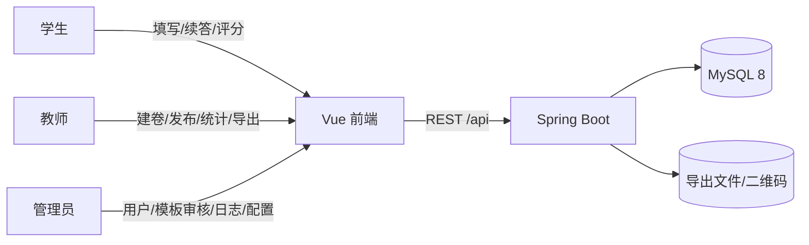
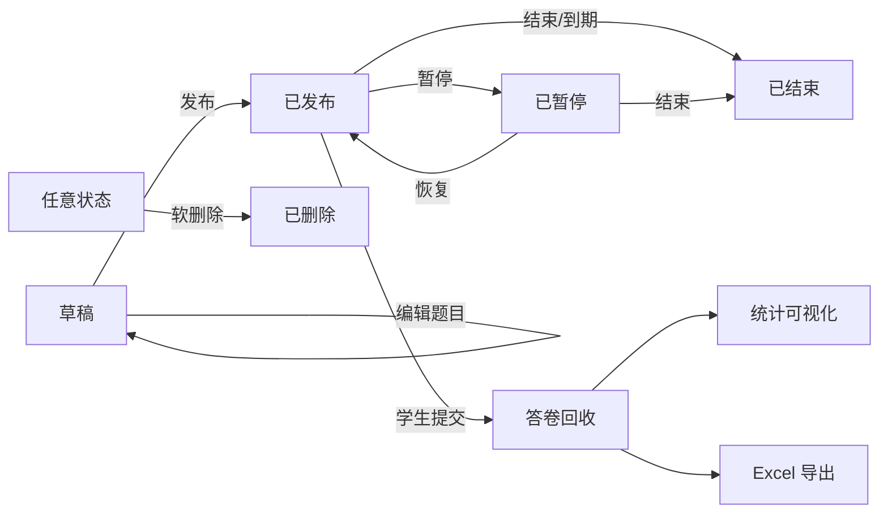

# 校园问卷信息调查管理系统 — 需求规格说明书（SRS）

| 项 | 内容 |
|---|---|
| 文档版本 | v0.1（需求基线草案） |
| 日期 | 2026-11-07 |
| 项目代号 | G14 |
| 技术栈 | Spring Boot 3.x + MyBatis-Plus + MySQL 8 / Vue 3 + Element Plus |
| 状态 | 待评审确认后冻结为 v1.0 |

配套文档：
- [功能清单](./功能清单.md)
- [权限矩阵](./权限矩阵.md)
- [验收标准](./验收标准.md)

---

## 1. 引言

### 1.1 目的
定义校园问卷信息调查管理系统的功能需求、数据需求、非功能需求与验收口径，作为接口设计、数据库设计、开发排期与期末答辩的依据。

### 1.2 范围
系统覆盖 **问卷创建 → 发布分发 → 在线填写 → 答卷回收 → 统计分析 → 数据导出** 的完整闭环，并附带模板共享审核、用户权限管理、操作审计三项支撑能力。

**不在范围内**（明确不做，防止范围蔓延）：
- 条件逻辑跳转、矩阵题、排序题、文件上传题
- 题目 × 题目的交叉分析、自定义报表设计器
- 微信 / SSO / 短信登录与通知
- 多院系多租户数据隔离
- 移动端原生 App

### 1.3 术语

| 术语 | 含义 |
|---|---|
| 问卷（Survey） | 一个调查单元，包含元信息与有序题目集合 |
| 题目（Question） | 问卷内的单个问题，含题型、题干、选项、是否必答 |
| 答卷（AnswerSheet） | 一次完整提交，对应一名填写人与一份问卷 |
| 草稿（Draft） | 未提交的作答中间态，可断点续答，不计入回收数 |
| 模板（Template） | 教师共享、经 ADMIN 审核后可供他人复用的问卷结构 |
| 发布者 | 具备 `survey:create` 权限的用户，非独立角色 |
| 单题统计 | 对单个题目做频次/占比/均值等聚合，不跨题 |

### 1.4 参考
- `AGENTS.md`：角色、技术栈、硬性指标
- 软工课程设计要求：P0 闭环、可演示、可验收

---

## 2. 项目概述

### 2.1 背景与目标
面向校园场景替代纸质与通用问卷工具：教师可快速建卷并回收数据，学生可便捷填写并在断网/中断后继续，管理员可集中管理账号、审核模板、追溯操作。

**成功标准**（全部满足才算达成）：
1. P0 功能闭环可端到端演示，无阻断性缺陷
2. 三条角色主流程各自可用，越权访问被后端拦截
3. 两项硬性非功能指标达到可度量、可复现的验收口径（见第 6 章）
4. 交付物齐全：需求、设计、接口、测试、部署、答辩材料

### 2.2 用户角色

| 角色 | 角色码 | 典型用户 | 核心诉求 |
|---|---|---|---|
| 系统管理员 | `ROLE_ADMIN` | 信息中心老师 / 助教 | 管人、管权限、审模板、看全量数据、查日志 |
| 教师 | `ROLE_TEACHER` | 任课教师、辅导员 | 建卷、发卷、看自己问卷的答卷与统计、导出、共享模板 |
| 学生 | `ROLE_STUDENT` | 在校学生 | 填卷、续答、看自己的填写记录、浏览评分模板 |

> **角色设计原则**：只有三个角色。"能否发布问卷"是权限（`survey:create`、`survey:publish:self`），默认授予 ADMIN 与 TEACHER。若学生干部需要发卷，给该学生单独授予权限，**不新增角色**。

### 2.3 运行环境

| 层 | 要求 |
|---|---|
| 服务端 | JDK 17、Spring Boot 3.x、MySQL 8.0、Maven |
| 客户端 | Chrome / Edge 最新两个大版本，最小可用宽度 1280px |
| 部署 | 前后端分离，Nginx 托管前端静态资源并反代 `/api`，见 `deploy/` |

### 2.4 设计约束
| 编号 | 约束 |
|---|---|
| C-01 | 所有接口统一前缀 `/api`，统一响应体 `{code, msg, data}` |
| C-02 | 前后端均做权限判断，**后端为唯一可信边界**；前端仅控制菜单与按钮显隐 |
| C-03 | 教师的数据范围限定为"自己创建的问卷"，必须在 SQL 层过滤，不得只在前端隐藏 |
| C-04 | 数据库表名小写下划线，主键 `id`，统一审计字段 `create_by / create_time / update_by / update_time / deleted` |
| C-05 | 前端依赖锁定稳定版：Vue 3.5.x、Vue Router 4.x、Pinia 3.x、Element Plus、ECharts |
| C-06 | 数据规模按**课程级**设计：用户 < 500，问卷 < 200，单问卷答卷 < 5000 |

---

## 3. 总体描述

### 3.1 系统上下文

### 3.2 核心业务主线

### 3.3 问卷状态机（强制）
| 状态 | 码值 | 可编辑题目 | 可被填写 | 可查看答卷 |
|---|---|---|---|---|
| 草稿 | `DRAFT` | ✅ | ❌ | ❌ |
| 已发布 | `PUBLISHED` | ❌（仅可改标题/简介/截止时间） | ✅ | ✅ |
| 已暂停 | `PAUSED` | ❌ | ❌ | ✅ |
| 已结束 | `CLOSED` | ❌ | ❌ | ✅ |
| 已删除 | `DELETED`（软删） | ❌ | ❌ | ❌ |

> **发布后锁定题目结构**：这是需求层的硬约束。已发布问卷若允许改题型/删题，会导致已收答卷与题目版本错位、统计错乱。需要改结构时，走"复制为新问卷 → 重新发布"。

### 3.4 模板状态机
`PENDING`（待审核）→ `APPROVED`（通过，可被浏览复用）/ `REJECTED`（驳回，附原因，可修改后重新提交）；`OFFLINE`（共享者主动下架）。

---

## 4. 功能需求

优先级说明：**P0** = 答辩必演示闭环；**P1** = 已确认纳入本期；**P2** = 本期不做，仅预留。

### 4.1 认证与账号（FR-AUTH）

| 编号 | 需求 | 角色 | 优先级 |
|---|---|---|---|
| FR-AUTH-01 | 使用 **学号/工号 + 密码** 登录，登录成功返回 JWT 与用户信息（含角色、权限码列表） | 全部 | P0 |
| FR-AUTH-02 | 账号由 ADMIN 单个新增或 Excel 批量导入；也支持用户自助注册，注册后状态为"待审核" | 全部 | P0 |
| FR-AUTH-03 | 密码使用 BCrypt 存储；连续登录失败 5 次锁定 10 分钟 | 全部 | P0 |
| FR-AUTH-04 | 主动登出（前端清 token + 后端记录登出日志）；token 过期后自动跳转登录页 | 全部 | P0 |
| FR-AUTH-05 | 修改密码：需校验原密码，新密码长度 ≥ 8 且含字母与数字 | 全部 | P0 |
| FR-AUTH-06 | 被禁用（`status=0`）或待审核的账号无法登录，提示明确原因 | 全部 | P0 |

**规则**
- R-AUTH-1：账号唯一键为 `username`（学号/工号），不可修改。
- R-AUTH-2：登录失败提示统一为"账号或密码错误"，不暴露账号是否存在。
- R-AUTH-3：JWT 有效期 2 小时，无刷新令牌（课程级简化），过期即重新登录。

### 4.2 用户与角色管理（FR-USER，仅 ADMIN）

| 编号 | 需求 | 优先级 |
|---|---|---|
| FR-USER-01 | 用户列表：按姓名/学工号/角色/状态搜索，分页 | P0 |
| FR-USER-02 | 新增用户（学工号、姓名、角色、初始密码、院系/班级） | P0 |
| FR-USER-03 | 编辑用户基本信息；重置密码（重置为默认值并标记首次登录须改密） | P0 |
| FR-USER-04 | 启用 / 禁用用户；禁用后立即失效（下次请求即被拒） | P0 |
| FR-USER-05 | 分配角色（单选主角色）；对个别用户追加/回收单项权限（如给学生干部 `survey:create`） | P0 |
| FR-USER-06 | Excel 批量导入用户，导入结果需回报"成功 N 条 / 失败 M 条 + 失败原因行号" | P0 |
| FR-USER-07 | 审核自助注册的待审核账号（通过 / 驳回） | P1 |

**规则**
- R-USER-1：ADMIN 不能禁用或删除自己；系统中至少保留 1 个可用 ADMIN。
- R-USER-2：角色变更写操作日志，记录变更前后值。

### 4.3 问卷创建与编辑（FR-SUR）

| 编号 | 需求 | 角色 | 优先级 |
|---|---|---|---|
| FR-SUR-01 | 新建问卷：标题、简介、分类（教学反馈/活动报名/满意度/其他）、匿名开关、起止时间、是否限填一次 | TEACHER/ADMIN | P0 |
| FR-SUR-02 | 题目管理：新增、编辑、删除、**拖拽排序**、复制题目 | TEACHER/ADMIN | P0 |
| FR-SUR-03 | 题型支持：单选、多选、单行文本、多行文本、评分（1–5 星） | TEACHER/ADMIN | P0 |
| FR-SUR-04 | 选项管理：增删改、排序；单选/多选题至少 2 个选项 | TEACHER/ADMIN | P0 |
| FR-SUR-05 | 每题可设"必答"；文本题可设最大字数 | TEACHER/ADMIN | P0 |
| FR-SUR-06 | 草稿自动保存（题目编辑过程中每 30s 或失焦时保存），刷新不丢失 | TEACHER/ADMIN | P0 |
| FR-SUR-07 | 问卷预览：以学生视角渲染，不产生答卷 | TEACHER/ADMIN | P0 |
| FR-SUR-08 | 复制问卷（含题目与选项），生成新的草稿 | TEACHER/ADMIN | P0 |
| FR-SUR-09 | 删除问卷：仅软删除；已有答卷的问卷需二次确认，删除后列表不可见、数据保留 | TEACHER/ADMIN | P0 |
| FR-SUR-10 | 我的问卷列表：按状态/关键词筛选，显示回收数、状态、时间 | TEACHER/ADMIN | P0 |
| FR-SUR-11 | ADMIN 可查看并管理**全量**问卷（含他人问卷），可强制下架 | ADMIN | P0 |

**规则**
- R-SUR-1：问卷至少 1 道题才能发布。
- R-SUR-2：发布后题目结构锁定（见 3.3）。
- R-SUR-3：结束时间必须晚于开始时间；不填则视为长期有效。
- R-SUR-4：教师只能编辑/删除/发布**自己创建**的问卷。

### 4.4 发布与分发（FR-PUB）

| 编号 | 需求 | 角色 | 优先级 |
|---|---|---|---|
| FR-PUB-01 | 发布问卷：状态置为 `PUBLISHED`，生成唯一分享码（短链 `shareCode`） | TEACHER/ADMIN | P0 |
| FR-PUB-02 | 生成分享链接与**二维码**，支持复制链接、下载二维码图片 | TEACHER/ADMIN | P0 |
| FR-PUB-03 | 通过分享码访问：未登录先跳登录页，登录后回到该问卷填写页 | 全部 | P0 |
| FR-PUB-04 | 暂停回收 / 恢复回收 | TEACHER/ADMIN | P0 |
| FR-PUB-05 | 提前结束问卷（不可逆，可延长截止时间但不能回到 `PUBLISHED`） | TEACHER/ADMIN | P0 |

**规则**
- R-PUB-1：`shareCode` 全局唯一，建议 8 位随机串，不可枚举敏感信息。
- R-PUB-2：问卷大厅仅展示 `PUBLISHED` 且在有效期内的问卷。
- R-PUB-3：截止时间到点后由**后端校验**拒绝提交，不依赖定时任务（定时任务仅用于状态展示的兜底）。

### 4.5 填写与草稿（FR-FILL）

| 编号 | 需求 | 角色 | 优先级 |
|---|---|---|---|
| FR-FILL-01 | 问卷大厅：可填问卷列表（卡片式），显示标题、简介、题量、剩余时间、是否已填 | STUDENT | P0 |
| FR-FILL-02 | 填写页逐题渲染，支持单选/多选/文本/评分控件 | 全部 | P0 |
| FR-FILL-03 | 提交前校验：必答题未答、文本超长、多选题为空 → 定位到首个错误题并高亮 | 全部 | P0 |
| FR-FILL-04 | **草稿自动保存 + 断点续答**：作答变化后 5s 防抖保存，重新进入时恢复 | 全部 | P0 |
| FR-FILL-05 | 提交成功页：显示回执（问卷名 + 提交时间），提供"查看我的记录"入口 | 全部 | P0 |
| FR-FILL-06 | 限填一次：已提交用户再次进入显示"已提交"页，不可重复作答 | 全部 | P0 |
| FR-FILL-07 | 我的填写记录：列出已提交问卷、提交时间、状态 | STUDENT | P0 |
| FR-FILL-08 | 匿名问卷：提交后不回显本人作答内容，仅显示"已提交" | 全部 | P0 |

**规则**
- R-FILL-1：草稿不算提交，不进入回收统计。
- R-FILL-2：同一 `(survey_id, user_id)` 只允许一条有效答卷，靠唯一索引 + 幂等校验双重保证。
- R-FILL-3：匿名问卷**后端仍存 `user_id`**（用于限填一次与"我的记录"），但任何面向发布者的接口都不得返回身份信息。
- R-FILL-4：`PAUSED` / `CLOSED` / 过期问卷拒绝进入填写页，直接提示原因。
- R-FILL-5：提交时问卷若已被暂停，后端拒绝并提示，前端降级为只读。

### 4.6 答卷管理（FR-ANS）

| 编号 | 需求 | 角色 | 优先级 |
|---|---|---|---|
| FR-ANS-01 | 答卷列表：按问卷筛选、按时间排序、分页；显示答卷编号、提交时间、填写人（仅非匿名卷） | TEACHER（自己的）/ADMIN | P0 |
| FR-ANS-02 | 答卷详情：逐题展示该份答卷的作答内容 | 同上 | P0 |
| FR-ANS-03 | 标记为无效答卷（不计入统计，可恢复） | 同上 | P0 |
| FR-ANS-04 | 删除单份答卷（软删，仅 ADMIN 或问卷创建者） | 同上 | P1 |
| FR-ANS-05 | 回收概览：已回收数、有效数、无效数、完成率 | 同上 | P0 |
| FR-ANS-06 | 匿名问卷的答卷列表**必须隐藏填写人列**，接口不返回 `user_id`/姓名 | 同上 | P0 |

### 4.7 统计与分析（FR-STAT）

| 编号 | 需求 | 角色 | 优先级 |
|---|---|---|---|
| FR-STAT-01 | 单题统计页：按题目逐题展示图表 | TEACHER（自己的）/ADMIN | P0 |
| FR-STAT-02 | 单选/多选题：各选项选择人数与占比（柱状图 + 饼图），多选题占比基于答题人数 | 同上 | P0 |
| FR-STAT-03 | 文本题：显示作答条数、作答列表（分页），可查看高频词（简单分词/词频） | 同上 | P0 |
| FR-STAT-04 | 评分题：平均分、各星级分布、参评人数 | 同上 | P0 |
| FR-STAT-05 | 图表基于 ECharts 渲染，支持导出图片（可选） | 同上 | P1 |
| FR-STAT-06 | 统计口径固定为"有效答卷"，无效答卷不计入 | 同上 | P0 |

**规则**
- R-STAT-1：统计结果按需查询、不做预聚合表（课程级数据量下足够）；接口响应 < 1s。
- R-STAT-2：题目无有效作答时展示"暂无数据"占位，不报错、不出现 NaN。

### 4.8 数据导出（FR-EXP）

| 编号 | 需求 | 角色 | 优先级 |
|---|---|---|---|
| FR-EXP-01 | 导出 Excel（`.xlsx`），含两个 Sheet：**明细**（一行一份答卷，一列一道题）与**汇总**（每题选项频次占比） | TEACHER（自己的）/ADMIN | P0 |
| FR-EXP-02 | 导出文件名含问卷标题与时间戳，中文不乱码 | 同上 | P0 |
| FR-EXP-03 | 数据量大时使用流式写出（EasyExcel），不得一次性全量加载到内存 | 同上 | P0 |

**规则**
- R-EXP-1：匿名问卷的明细 Sheet 不含填写人与学工号列。
- R-EXP-2：导出行为写操作日志（谁、何时、导出了哪份问卷）。

### 4.9 模板中心（FR-TPL，本期 P1）

| 编号 | 需求 | 角色 | 优先级 |
|---|---|---|---|
| FR-TPL-01 | 教师可将自己的问卷"共享为模板"（复制结构，附模板名、适用场景、分类） | TEACHER | P1 |
| FR-TPL-02 | 模板提交后状态为 `PENDING`，经 ADMIN 审核通过才在模板中心可见 | TEACHER | P1 |
| FR-TPL-03 | ADMIN 模板审核列表：查看模板内容、通过、驳回（必填驳回原因） | ADMIN | P1 |
| FR-TPL-04 | 模板中心：学生/教师可浏览已通过模板，按分类与评分排序，查看模板详情（题目结构与预览） | 全部 | P1 |
| FR-TPL-05 | 学生对模板评分（1–5 星，一人一模板一票，可修改） | STUDENT | P1 |
| FR-TPL-06 | 教师"使用模板"：一键复制为**自己的新问卷草稿**，不影响原模板 | TEACHER/ADMIN | P1 |
| FR-TPL-07 | 共享者可下架自己的模板 | TEACHER | P1 |

**规则**
- R-TPL-1：模板与问卷解耦——问卷后续修改不影响已共享模板的快照内容。
- R-TPL-2：评分平均值保留 1 位小数；无评分时显示"暂无评分"。

### 4.10 日志与审计（FR-LOG，ADMIN）

| 编号 | 需求 | 优先级 |
|---|---|---|
| FR-LOG-01 | 登录日志：账号、IP、时间、结果（成功/失败/锁定），可筛选分页 | P0 |
| FR-LOG-02 | 操作日志：记录发布、暂停、结束、删除、导出、权限变更、模板审核等关键动作，含操作人、对象、时间、结果 | P0 |
| FR-LOG-03 | 日志仅可查询与导出，**不提供修改与删除入口** | P0 |

### 4.11 系统配置（FR-CFG，ADMIN）

| 编号 | 需求 | 优先级 |
|---|---|---|
| FR-CFG-01 | 维护系统名称、Logo、公告文案 | P1 |
| FR-CFG-02 | 维护默认密码、密码策略（长度/复杂度开关） | P1 |
| FR-CFG-03 | 配置项键值对存储，前端读取公开配置渲染站点信息 | P1 |

---

## 5. 数据需求

### 5.1 实体清单

| 表 | 说明 | 关键约束 |
|---|---|---|
| `sys_user` | 用户 | `username` 唯一；`status` 0/1 |
| `sys_role` | 角色 | `code` 唯一（三值） |
| `sys_permission` | 权限码字典 | `code` 唯一 |
| `sys_user_role` | 用户-角色 | `(user_id, role_id)` 唯一 |
| `sys_role_permission` | 角色-权限 | `(role_id, perm_id)` 唯一 |
| `sys_user_permission` | 用户级追加权限 | `(user_id, perm_id)` 唯一 |
| `survey` | 问卷 | `share_code` 唯一；`status` 枚举；`deleted` 软删 |
| `survey_question` | 题目 | `(survey_id, sort_no)` |
| `survey_question_option` | 选项 | `(question_id, sort_no)` |
| `answer_sheet` | 答卷头 | **`(survey_id, user_id)` 唯一**；`is_valid` |
| `answer_item` | 答案明细 | `(sheet_id, question_id)` 唯一 |
| `survey_draft` | 草稿 | `(survey_id, user_id)` 唯一，存 JSON |
| `survey_template` | 模板 | 关联来源问卷；`status` 枚举 |
| `template_rating` | 模板评分 | `(template_id, user_id)` 唯一 |
| `operation_log` / `login_log` | 日志 | 只增不改 |
| `sys_config` | 配置 | `config_key` 唯一 |

### 5.2 关键设计决策（待确认）

| 编号 | 决策点 | 推荐方案 | 影响 |
|---|---|---|---|
| D-01 | 选项类答案如何存 | `answer_item` 单表：`text_value`（文本）+ `number_value`（评分）+ `option_values`（JSON 数组存选项 id） | 统计用 `JSON_CONTAINS`/`JSON_LENGTH`，MySQL 8 支持；省一张表，代价是统计 SQL 稍复杂 |
| D-02 | 草稿存 JSON 还是明细表 | `survey_draft.answers_json` 存整卷 JSON | 草稿不参与统计，无需结构化；免去明细表同步成本 |
| D-03 | 权限存储 | RBAC 五表 + 用户级追加权限表 | 满足"学生干部加权限不加角色"的要求 |
| D-04 | 软删策略 | 全部业务表 `deleted` 标记，MyBatis-Plus 逻辑删除 | 保留审计可追溯 |

### 5.3 索引要点
- `answer_sheet(survey_id, user_id)` 唯一索引 —— 幂等防重提交的关键
- `answer_sheet(survey_id, create_time)` 复合索引 —— 答卷列表与导出
- `answer_item(sheet_id)`、`answer_item(question_id)` —— 统计聚合
- `survey(create_by, status, deleted)` —— "我的问卷"列表
- `survey(share_code)` 唯一 —— 分享链接解析

---

## 6. 非功能需求

### 6.1 性能（硬性指标 1）

| 项 | 要求 |
|---|---|
| 目标 | 高并发答卷提交场景 **P95 响应时间 < 3 秒** |
| 场景 | 100 并发用户同时提交答卷（含查询问卷、保存草稿、提交答卷三类请求混合，提交占 70%） |
| 压测工具 | JMeter，100 线程，ramp-up 10s，持续 5 分钟 |
| 通过条件 | ① 提交接口 P95 < 3s、平均 < 1.5s；② 错误率 < 0.1%；③ 数据库无死锁/重复答卷；④ 答卷总数 = 预期提交数 |
| 保障手段 | 唯一索引幂等、连接池调优（HikariCP）、避免 N+1 查询、统计接口分页、导出流式写出 |

### 6.2 稳定性（硬性指标 2）

| 项 | 要求 |
|---|---|
| 目标 | 长期运行 **故障率 < 0.1%** |
| 口径定义 | 故障率 = (5xx 响应数 + 请求超时数 + 连接被拒数) / 总请求数。**4xx 业务错误（如未登录、重复提交、参数校验失败）不计入故障**，但需单独统计并在文档中说明 |
| 测量方式 | ① 24 小时持续压测日志统计；② 答辩前一周实际使用期间的访问日志统计 |
| 通过条件 | 两种方式统计结果均 < 0.1%，且无内存泄漏（堆内存稳定）、无连接泄漏 |

### 6.3 安全
- 密码 BCrypt 加盐存储，日志与接口响应永不返回密码字段
- JWT 无状态鉴权，接口级权限校验（后端拦截器 + 注解）
- 越权防护：所有"按 id 操作"的接口必须校验资源归属（教师 A 不得操作教师 B 的问卷/答卷/导出）
- SQL 注入：MyBatis 全部使用 `#{}` 参数绑定，禁止字符串拼接
- XSS：文本类答案入库前过滤/转义，渲染时不做 `v-html`
- 导出与统计接口限流（同用户 1 分钟 5 次），防资源耗尽
- 敏感操作（删除、权限变更、导出）二次确认 + 操作日志

### 6.4 易用性
- 表单校验即时反馈，错误定位到具体字段
- 所有列表支持分页与空状态提示
- 关键操作有成功/失败 Toast 提示
- 填写页显示进度（第 N 题 / 共 M 题）

### 6.5 可维护性
- 统一响应体与统一异常处理，错误码集中定义
- 分层：Controller → Service → Mapper，禁止 Controller 直连 Mapper 写业务
- 接口文档用 OpenAPI（springdoc）自动生成，随代码更新
- 前后端目录约定见 `backend/AGENTS.md`、`frontend/AGENTS.md`

### 6.6 兼容性
- 服务端 JDK 17，MySQL 8.0（字符集 `utf8mb4`）
- 浏览器：Chrome / Edge 最新两个大版本

---

## 7. 约束、假设与依赖

**假设**
- A-01：用户身份来自校内学工号体系，本期不自建统一认证
- A-02：系统部署在校内网或单机云服务器，无需考虑跨地域
- A-03：单实例部署，不涉及集群与分布式会话

**依赖**
- DEP-01：MySQL 8.0 可用
- DEP-02：Maven 依赖可从仓库拉取
- DEP-03：前端依赖可降级安装（见 C-05）

**技术债预警**
| 编号 | 现状 | 处理建议 |
|---|---|---|
| TD-01 | `frontend/G14/package.json` 使用 `vue: "rc"`、`vue-router ^5`、`pinia ^4` | 按 C-05 降级并锁定版本，先做一次 `npm install` 冒烟验证 |
| TD-02 | `backend/pom.xml` 仅 `spring-boot-starter-web`，Spring Boot 3.0.2 | 补 MyBatis-Plus、mysql-connector-j、validation、security 或 JWT 库、EasyExcel、springdoc；建议升到 3.2.x/3.3.x 稳定版 |
| TD-03 | 示例代码 `demos/web/*` 为 IDE 生成 | 开发前删除，避免与真实接口冲突 |
| TD-04 | `application.properties` 中文注释乱码（GBK 写入） | 统一 UTF-8 保存，或改用 `application.yml` |
| TD-05 | `docs/`、`deploy/` 目录缺失 | 本次补齐 `docs/requirements`，其余随设计阶段补 |

---

## 8. 交付里程碑（建议）

| 阶段 | 产出 | 关键验收 |
|---|---|---|
| M1 需求冻结 | 本 SRS + 功能清单 + 权限矩阵 + 验收标准 | 四份文档评审通过 |
| M2 设计 | 数据库 DDL、接口文档、页面原型与路由表 | 表结构覆盖全部实体，接口覆盖 P0 功能 |
| M3 骨架 | 登录 + 权限拦截 + 用户管理 + 统一响应/异常 | 三角色可登录，越权被拦截 |
| M4 P0 闭环 | 建卷 → 发布 → 填写 → 统计 → 导出 | 端到端演示通过 |
| M5 P1 增量 | 模板中心 + 审核 + 评分 + 系统配置 + 日志完善 | 模板全流程可演示 |
| M6 测试与压测 | 测试用例执行记录、JMeter 报告、缺陷清单 | 两项硬指标达标 |
| M7 答辩 | PPT、演示脚本、部署文档 | 演示无阻断 |
